<p align="center">
  
</p>

Hoi, ik ben **Ayoub**. Fullstack developer uit Rotterdam en student Software developer (mbo 4) aan het Techniek College Rotterdam. Ik bouw van database tot interface.

```csharp
public class Ayoub : Developer
{
    public string   Rol   => "Fullstack";
    public string   Stad  => "Rotterdam";
    public string   Nu    => "Stage bij Staffin, Hoogvliet";
    public string[] Stack => ["C#", "Laravel", "SQL", "JavaScript"];
}
```

## Stack

<p align="center">
  
</p>

## Projecten

```sql
SELECT naam, wat, stack FROM projecten ORDER BY jaar DESC;
```

| naam | wat | stack |
| --- | --- | --- |
| **KAM Meldbot**<br><sub>privé repo · 2026</sub> | WhatsApp-bot waarmee medewerkers veiligheidsincidenten melden. AI zet een los bericht, ook een spraakbericht, om in het officiële meldformulier en slaat het op in de database. | `Node.js` `T-SQL` `Azure` `OpenAI API` |
| **Datakwaliteit Entra ID & ERP**<br><sub>privé · 2026</sub> | Regels opgesteld waar bedrijfsdata aan moet voldoen: 868 voor het ERP-systeem en 103 voor Entra ID. Met een validator die accounts automatisch controleert. | `Azure` `Entra ID` |
| [**Balatro in C#**](https://github.com/Ayoub17-dev/project-balatro)<br><sub>2026</sub> | Console-versie van het kaartspel Balatro. Herkent alle tien pokerhanden. Speciale kaarten erven van één `Card`-klasse en krijgen zo hun eigen regels. | `C#` `.NET` `OOP` |
| [**Chirpify**](https://github.com/Ayoub17-dev/chirpify)<br><sub>2025</sub> | Social-media-app in de stijl van Twitter: account aanmaken, inloggen en berichten plaatsen. | `PHP` `MySQL` `JavaScript` |
| **Cookie Clicker OOP**<br><sub>duo-project · 2025</sub> | Klikspel in objectgeoriënteerd JavaScript, eerst ontworpen met een use-case- en klassendiagram. | `JavaScript` `OOP` `UML` |

<sub>5 rijen · 0,00 sec</sub>

## Contact

**Mail:** makriniel@icloud.com<br>
**Plek:** Rotterdam, NL
